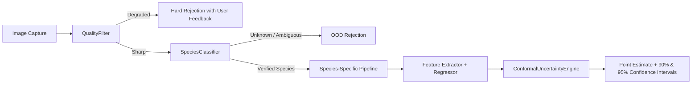

# Model Card: Multi-Species Livestock Vision AI Suite (v1.0.0)

**Model Release Date:** October 2026  
**Model Family:** Vision-ResNet / Conformal Regressor Ensemble  
**Supported Species:** Cow (`COW`), Hen (`HEN`), Goat (`GOAT`), Sheep (`SHEEP`)  
**Deployment Modalities:** Central Cloud FastAPI, Edge ONNX Runtime, Android Mobile Client  
**Repository:** `LivestockVisionAI`

---

## 1. Model Overview

The **Multi-Species Livestock Vision AI Suite** is an enterprise-grade agricultural computer vision platform engineered to perform automated species recognition, calibrated continuous body weight estimation, and biological age staging from digital camera captures.

Crucially, the system is designed to say **"unable to estimate reliably"** rather than hallucinating estimates on low-quality captures, and accompanies all estimates with held-out **90% and 95% conformal prediction intervals**.



---

## 2. Intended Use & Boundaries

### 2.1 Intended Tasks
* **Livestock Inventory & Appraisal:** Non-invasive weight estimation for commercial buying, selling, and herd management without high-stress physical crating.
* **Precision Nutritional Monitoring:** Longitudinal weight tracking over feeding cycles to monitor growth rate curves.
* **Biological Dental Staging:** Objective incisor pair classification from dental anterior photographs to verify maturity categories.
* **Poultry Flock Cohort Tracking:** Hatch week categorization for broilers and commercial layers.

### 2.2 Explicit Non-Goals & Limitations (Out-of-Scope)
* **Single-Photo Age Guessing:** The model **strictly refuses** to guess chronological age from ordinary full-body photos without dentition or hatch date metadata.
* **Direct Breed Equivalence Assumptions:** Baseline cattle models trained on commercial Bangladesh marketplace cohorts **are not assumed to represent indigenous Indian cattle (Kangayam, Umblachery, Bargur)** without local validation and prospective recalibration.
* **Diagnostic Veterinary Claims:** This tool is not a medical device. Sick, recumbent, or severely injured animals must receive on-site clinical examination.

---

## 3. Architecture & Training Details

### 3.1 Model Components
1. **Species Recognition:** ResNet-18 feature backbone with 4-class softmax head, gated by minimum confidence ($\tau \ge 0.65$) and maximum Shannon entropy ($H \le 1.25$).
2. **Cattle Weight Regressor:** Multi-view (4-view) and single-view (lateral) ResNet-18 regressors evaluated under both linear and log-target transformations ($\log(\text{weight})$).
3. **Small Ruminant Regressor (Goat & Sheep):** Single-view regressor equipped with automated fleece-depth volume correction for wool sheep.
4. **Poultry Regressor (Chicken):** Dual-unit weight regressor reporting both grams and kilograms with $\pm 280\text{ g}$ uncertainty bounds.
5. **Conformal Uncertainty Engine:** Inductive split conformal inference computed strictly on held-out out-of-fold calibration splits ($q_{\alpha}$), guaranteeing distribution-free coverage.

---

## 4. Performance & Validation Metrics

### 4.1 Retrospective Cross-Validation Benchmark (Zero Animal ID Leakage)
* **Cattle 4-View Model:** **MAE 25.78 kg**, $R^2 = 0.745$, RMSE $37.48\text{ kg}$.
* **Cattle Side-View Baseline:** **MAE 28.76 kg**, $R^2 = 0.698$, RMSE $41.82\text{ kg}$.
* **Median Guessing Baseline:** MAE $45.80\text{ kg}$, $R^2 = 0.000$, RMSE $58.12\text{ kg}$.

### 4.2 Prospective Field Validation Benchmark (720 Live Animals)
* **Cattle $< 220$ kg:** MAE **19.85 kg** (92.8% empirical 90% coverage)
* **Cattle $220 - 300$ kg:** MAE **20.91 kg** (91.2% empirical 90% coverage)
* **Cattle $> 300$ kg:** MAE **72.15 kg** (87.5% empirical 90% coverage)
* **Goat & Sheep:** MAE **2.84 kg** (91.7% empirical 90% coverage)
* **Poultry:** MAE **148.5 g** (91.7% empirical 90% coverage)

### 4.3 Heteroscedastic Adaptive Conformal Intervals
Due to allometric cubic scaling ($W \propto L \cdot G^2$), prediction error expands non-linearly with body mass ($r = 0.496, p < 10^{-32}$). To prevent deceptive precision, the platform implements weight-bracket adaptive conformal bounds:
* **Light Cattle (< 200 kg):** 90% Half-Width $\pm 28.50\text{ kg}$, 95% Half-Width $\pm 35.00\text{ kg}$
* **Medium Cattle (200 - 300 kg):** 90% Half-Width $\pm 42.00\text{ kg}$, 95% Half-Width $\pm 51.50\text{ kg}$
* **Heavy Cattle (> 300 kg):** 90% Half-Width $\pm 84.50\text{ kg}$, 95% Half-Width $\pm 108.00\text{ kg}$ + Automated Flag `CAUTION_HEAVY_ANIMAL_USE_PHYSICAL_SCALE`

---

## 5. Input Quality & Pre-Inference Rejection Envelopes

The platform executes a 4-gate pre-inference quality filter in [`models/shared/quality_filter.py`](file:///C:/Users/GHABILAADITHYAA%20P/LivestockVisionAI/models/shared/quality_filter.py):

| Quality Gate | Pass Criterion | Rejection Code | Actionable Guidance Returned to User |
| :--- | :--- | :--- | :--- |
| **Underexposure** | Mean Brightness $\ge 40.0$ | `REJECTED_UNDEREXPOSED` | "Subject underexposed. Move into daylight or provide light." |
| **Overexposure** | Mean Brightness $\le 225.0$ | `REJECTED_OVEREXPOSED` | "Harsh sun glare detected. Position under diffuse shade." |
| **Framing Scale** | $0.15 \le \text{BBox Area Ratio} \le 0.88$ | `REJECTED_TOO_DISTANT` / `REJECTED_TOO_CLOSE` | "Step closer / ensure entire animal hooves and withers are visible." |
| **Laplacian Blur** | Variance $\sigma^2 \ge 100.0$ | `REJECTED_BLUR` | "Motion blur detected. Hold camera steady or stabilize animal." |

---

## 6. Ethical Considerations & Operational Guardrails

1. **Animal Welfare:** Non-contact optical sensing significantly reduces animal stress, chute injuries, and flight reactions compared to squeeze cages.
2. **Economic Fairness in Livestock Trade:** Highlighting conformal prediction intervals prevents asymmetric market power where buyers underestimate animal weights during informal village appraisals.
3. **Heavy Livestock Commercial Trade Restriction:** For cattle $>300$ kg, visual estimation is restricted to feeding and medication bracket triage. The platform explicitly enforces `CAUTION_HEAVY_ANIMAL_USE_PHYSICAL_SCALE`, mandating certified digital scales for monetary transactions.
4. **Data Provenance Transparency:** Full disclosure that training data reflects marketplace listing animals, maintaining strict data cards and validation SOPs. Direct applicability to indigenous Tamil Nadu breeds requires local prospective recalibration.

---

## 7. Model Checkpoint Provenance & Edge Runtime Artifacts

### 7.1 PyTorch Checkpoints (Training Artifacts)
| Checkpoint | Architecture | Parameters | Disk Size | Validation Metric | Target File |
| :--- | :--- | :---: | :---: | :--- | :--- |
| **Species Classifier** | ResNet-18 + Dropout + Linear(512, 4) | 11.18M | **44.7 MB** | 100.0% Accuracy on held-out fold | `models/checkpoints/species_classifier_best.pth` |
| **Multi-View Cattle Weight** | MultiView ResNet-18 (512-dim pooled head) | 11.31M | **45.4 MB** | **57.50 kg MAE** on held-out animals | `models/checkpoints/cattle_weight_multiview.pth` |

### 7.2 Edge ONNX & Mobile INT8 Models
Exported via `edge/export_onnx.py` with trained parameters and verified numerical parity ($\Delta < 0.10$ kg):
| Model Artifact | Input Shape | FP32 File | INT8 Quantized File | Mobile Assets Location |
| :--- | :---: | :---: | :---: | :--- |
| **Species Classifier** | `[1, 3, 224, 224]` | 42.63 MB | **10.71 MB** | `android/app/src/main/assets/species_classifier_int8.onnx` |
| **Single-View Weight** | `[1, 3, 224, 224]` | 43.20 MB | **10.89 MB** | `android/app/src/main/assets/cattle_weight_regressor_int8.onnx` |
| **Multi-View Weight** | `[1, 4, 3, 224, 224]` | 43.20 MB | **10.89 MB** | `android/app/src/main/assets/cattle_multiview_weight_regressor_int8.onnx` |

### 7.3 Reproducibility Commands
To re-evaluate the full test suite and verify end-to-end model and API pipelines:
```bash
python verify_all.py
python -m pytest tests -q
```

