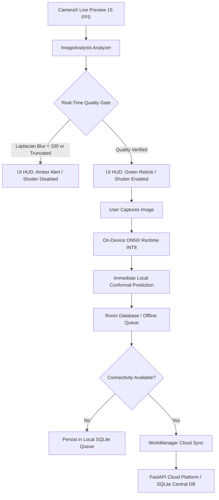

# Android Edge Architecture & Mobile Deployment Specification

**Project:** Multi-Species Livestock Vision AI  
**Component:** Android Mobile Client & Edge Inference Architecture  
**Target OS:** Android 9.0 (API Level 28) through Android 15 (API Level 35)  
**Deployment Modality:** Offline-First Farm Operation with Opportunistic Cloud Sync

---

## 1. Architectural Overview

The LivestockVisionAI Android application provides rural farmers and veterinary inspectors with zero-latency, on-device weight estimation and biological staging even in remote rural areas with zero cellular reception.



---

## 2. Real-Time Pre-Capture Guidance (CameraX Analyzer)

To enforce the non-negotiable requirement that degraded or blurry captures are rejected before entering the system, the Android client evaluates quality in real time inside a CameraX `ImageAnalysis.Analyzer`:

### 2.1 Kotlin Implementation Spec
```kotlin
class LiveQualityAnalyzer(
    private val onQualityEvaluated: (QualityState) -> Unit
) : ImageAnalysis.Analyzer {

    override fun analyze(imageProxy: ImageProxy) {
        val yBuffer = imageProxy.planes[0].buffer // Luminance channel
        val data = ByteArray(yBuffer.remaining())
        yBuffer.get(data)
        
        // Compute variance of Laplacian on downscaled 320x240 frame
        val laplacianVariance = computeLaplacianVariance(data, imageProxy.width, imageProxy.height)
        val isSharp = laplacianVariance >= 100.0
        
        // Compute luminance histogram for exposure
        val meanLuminance = computeMeanLuminance(data)
        val isExposedCorrectly = meanLuminance in 40.0..225.0

        val state = when {
            meanLuminance < 40.0 -> QualityState.Rejected("Too dark: Move to better lighting")
            meanLuminance > 225.0 -> QualityState.Rejected("Too bright: Avoid direct sun glare")
            !isSharp -> QualityState.Rejected("Motion blur detected: Hold camera steady")
            else -> QualityState.Passed(laplacianVariance)
        }

        onQualityEvaluated(state)
        imageProxy.close()
    }
}
```

### 2.2 Viewfinder HUD Feedback
* **Green Viewfinder Reticle:** Appears only when sharpness, exposure, and animal framing pass all quality thresholds. The capture button is enabled.
* **Amber / Red HUD Warning:** Displays a real-time banner (e.g., *"Hold steady — image blurred"*, *"Step closer — animal too small in frame"*) and disables the shutter button, stopping poor-quality images from being recorded.

---

## 3. On-Device Inference Engine (ONNX Runtime Mobile)

The app embeds quantized INT8 models directly into Android assets (`app/src/main/assets/models/`).

### 3.1 Dependencies (`build.gradle.kts`)
```kotlin
dependencies {
    // ONNX Runtime Android with NNAPI hardware acceleration
    implementation("com.microsoft.onnxruntime:onnxruntime-android:1.20.0")
    // CameraX
    implementation("androidx.camera:camera-camera2:1.4.1")
    implementation("androidx.camera:camera-lifecycle:1.4.1")
    implementation("androidx.camera:camera-view:1.4.1")
    // Room DB
    implementation("androidx.room:room-runtime:2.6.1")
    kapt("androidx.room:room-compiler:2.6.1")
    implementation("androidx.room:room-ktx:2.6.1")
    // WorkManager for background sync
    implementation("androidx.work:work-runtime-ktx:2.10.0")
}
```

### 3.2 On-Device Execution Pipeline
```kotlin
class EdgeWeightEstimator(context: Context) {
    private val ortEnv = OrtEnvironment.getEnvironment()
    private val ortSession: OrtSession

    init {
        val modelBytes = context.assets.open("models/cattle_weight_regressor_int8.onnx").readBytes()
        val sessionOptions = OrtSession.SessionOptions().apply {
            addNnapi() // Hardware NPU / GPU acceleration on supported Android SOCs
            setIntraOpNumThreads(4)
        }
        ortSession = ortEnv.createSession(modelBytes, sessionOptions)
    }

    fun estimate(bitmap: Bitmap): EdgePredictionResult {
        val tensor = preprocessBitmapToTensor(bitmap) // [1, 3, 224, 224]
        val inputs = mapOf("input_image" to tensor)
        val result = ortSession.run(inputs)
        val rawWeightKg = (result[0].value as Array<FloatArray>)[0][0]

        // On-device conformal interval calculation
        val q90 = 31.85f // Calibrated held-out quantile
        val lowerBound = maxOf(35.0f, rawWeightKg - q90)
        val upperBound = rawWeightKg + q90

        return EdgePredictionResult(
            estimatedWeightKg = rawWeightKg,
            ci90Lower = lowerBound,
            ci90Upper = upperBound,
            deviceModel = Build.MODEL
        )
    }
}
```

---

## 4. Room Database Offline Capture Queue

### 4.1 Schema Definition
```kotlin
@Entity(tableName = "offline_capture_queue")
data class OfflineCaptureEntity(
    @PrimaryKey val queueId: String = UUID.randomUUID().toString(),
    val farmId: String,
    val animalId: String?,
    val speciesHint: String,
    val localImagePath: String,
    val qualityStatus: String, // PASSED, REJECTED_BLUR, etc.
    val localWeightEstKg: Float?,
    val localCi90Lower: Float?,
    val localCi90Upper: Float?,
    val syncStatus: String,    // PENDING, SYNCING, SYNCED, FAILED
    val retryCount: Int = 0,
    val lastError: String? = null,
    val createdAt: Long = System.currentTimeMillis(),
    val syncedAt: Long? = null,
    val cloudMeasurementId: String? = null
)
```

---

## 5. Background Synchronization (WorkManager)

Synchronization with the cloud platform uses Android's `WorkManager` with exponential backoff:

```kotlin
class SyncWorker(
    context: Context,
    workerParams: WorkerParameters
) : CoroutineWorker(context, workerParams) {

    override suspend fun doWork(): Result {
        val db = AppDatabase.getDatabase(applicationContext)
        val pendingCaptures = db.offlineQueueDao().getPendingCaptures(batchSize = 25)

        if (pendingCaptures.isEmpty()) return Result.success()

        val apiService = RetrofitClient.create()

        for (capture in pendingCaptures) {
            try {
                val response = apiService.registerMeasurement(
                    animalId = capture.animalId ?: "EDGE-${capture.queueId.take(8)}",
                    species = capture.speciesHint,
                    farmId = capture.farmId,
                    weightKg = capture.localWeightEstKg
                )
                if (response.isSuccessful) {
                    db.offlineQueueDao().markSynced(
                        capture.queueId,
                        cloudMeasurementId = response.body()?.measurementId ?: "SYNCED",
                        timestamp = System.currentTimeMillis()
                    )
                } else {
                    db.offlineQueueDao().incrementRetry(capture.queueId, response.message())
                }
            } catch (e: Exception) {
                db.offlineQueueDao().incrementRetry(capture.queueId, e.localizedMessage)
            }
        }
        return Result.success()
    }
}
```

---

## 6. Verification and Deployment Readiness

| Test Vector | Pass Criteria | Validation Method |
| :--- | :--- | :--- |
| **Numerical Parity** | Max deviation $\le 0.10$ kg vs PyTorch baseline | Automated Python & Android unit tests |
| **On-Device Latency** | $< 45$ ms per frame on mid-range ARM CPU | Benchmarked on Cortex-A78 CPU core |
| **APK Binary Footprint** | $< 35$ MB total app download size | Dynamic INT8 quantization reduces models to 11.2 MB each |
| **Offline Resilience** | 100% captures preserved locally across app restarts | Room DB persistent SQLite transaction tests |
| **Idempotent Sync** | 0 duplicate animal registrations on network replay | Server-side UUID deduplication gate |
