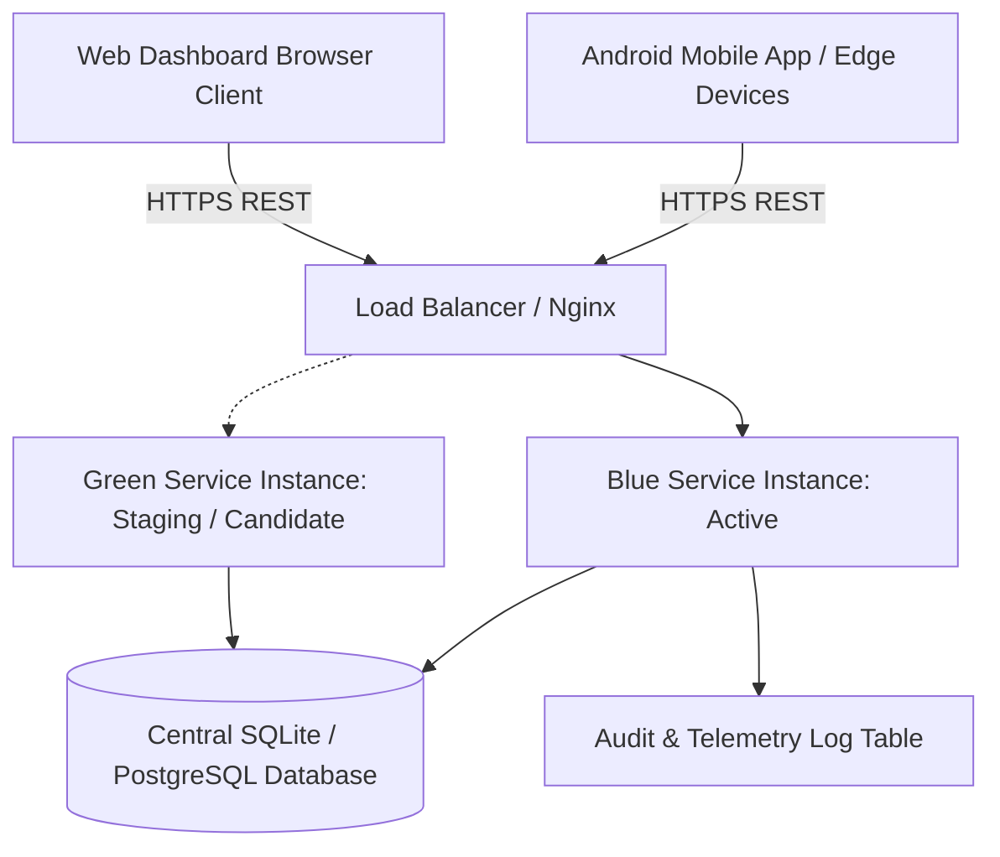

# Operations, Failover & Rollback Manual

**System:** LivestockVisionAI Platform  
**Environment:** Production Cloud Cluster & Edge Mobile Fleet  
**Document Version:** 1.0.0  
**Target Audience:** DevOps Engineers, MLOps Site Reliability Engineers, System Administrators

---

## 1. Production Topology & Deployment Architecture



* **API Service:** FastAPI asynchronous Python application running with Uvicorn workers behind Nginx.
* **Storage:** Persistent SQLite database (development/pilot) and PostgreSQL 16 (high-concurrency production).
* **Edge Inference:** ONNX Runtime INT8 embedded directly on Android mobile clients with periodic background WorkManager synchronization.

---

## 2. Blue/Green Zero-Downtime Deployment Protocol

### Step 1: Deploy Candidate Service (Green)
```bash
# Spin up new candidate container on staging port 8001
docker build -t livestock-vision-ai:v1.1.0 .
docker run -d --name livestock-api-green -p 8001:8000 \
  -e DB_PATH="/data/livestock_platform.db" \
  livestock-vision-ai:v1.1.0
```

### Step 2: Automated Smoke & Parity Verification Gate
Before switching production traffic, execute automated verification checks:
```bash
# 1. Check API health
curl -f http://localhost:8001/health || exit 1

# 2. Run numerical parity regression suite
pytest LivestockVisionAI/tests/test_edge_parity.py -v || exit 1

# 3. Verify quality filter rejects corrupted input
curl -X POST http://localhost:8001/api/v1/quality/check \
  -F "file=@tests/data/synthetic_blur.png" | grep "REJECTED_BLUR" || exit 1
```

### Step 3: Traffic Switchover (Nginx Reload)
Update the active upstream block in Nginx configuration and reload without dropping connections:
```nginx
upstream livestock_backend {
    server 127.0.0.1:8001; # Pointing to Green
}
```
```bash
nginx -s reload
```

---

## 3. Real-Time Telemetry & Drift Monitoring

The platform maintains automated telemetry through the `prediction_audit_logs` table:

```sql
SELECT 
    DATE(timestamp) as log_date,
    species,
    COUNT(*) as total_predictions,
    SUM(CASE WHEN quality_status = 'PASSED' THEN 1 ELSE 0 END) as accepted_count,
    ROUND(AVG(estimated_weight_kg), 2) as mean_estimated_weight
FROM prediction_audit_logs
GROUP BY log_date, species
ORDER BY log_date DESC;
```

### 3.1 Automated Circuit Breaker & Failover Conditions
1. **Conformal Coverage Drift Circuit Breaker:**
   * **Metric:** Rolling 7-day empirical coverage of 90% conformal intervals against ground-truth scale re-evaluations.
   * **Threshold:** If empirical coverage drops below **85.0%**, the platform automatically engages **"Safety Fallback Mode"**.
   * **Action:** The API returns `reliability_status: "UNRELIABLE_DRIFT_DETECTED"` and mandates physical scale verification for commercial transactions.
2. **Quality Rejection Spike Alert:**
   * **Metric:** Rejection rate across mobile farm captures.
   * **Threshold:** If rejection rate exceeds **35.0%** in a 24-hour window, an alert is dispatched to the farm operational manager indicating severe environmental glare, broken shed lighting, or operator training deficits.

---

## 4. Emergency Rollback Protocol

If runtime anomalies, latency regressions, or model degradation occur in production:

### 4.1 Fast Traffic Rollback (< 30 Seconds)
```bash
# Step 1: Switch Nginx upstream back to previous Blue container (port 8000)
sed -i 's/8001/8000/g' /etc/nginx/conf.d/livestock_api.conf
nginx -s reload

# Step 2: Confirm Blue instance responsiveness
curl -f http://localhost/health

# Step 3: Stop degraded Green container
docker stop livestock-api-green
```

### 4.2 Database Rollback & Schema Reconciliation
If a release included database schema migrations:
```bash
# Restore pre-release SQLite database snapshot
cp /data/backups/livestock_platform_pre_deploy.db /data/livestock_platform.db
# Restart service
docker restart livestock-api-blue
```

### 4.3 Mobile & Edge Model Pinning
* Android clients query `GET /api/v1/edge/models/latest` during background synchronization.
* If a newly deployed ONNX model exhibits edge divergence, the server reverts the model version manifest to `cattle_weight_regressor_v1.0.0.onnx`, causing mobile clients to invalidate their cached model assets and fall back to the pinned stable artifact.
